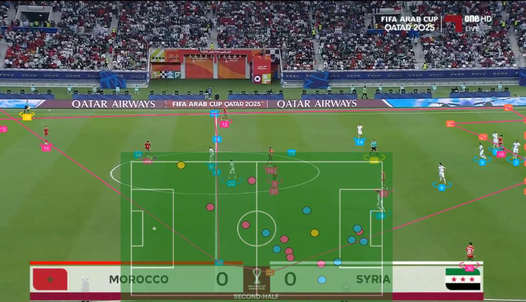
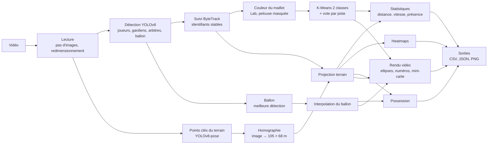

# ArabCupVision

Analyse automatique de vidéos de football : détection et suivi des joueurs, assignation des équipes, projection sur un terrain 2D et statistiques individuelles, le tout exécutable sur un simple CPU.

## Aperçu



*Aperçu : capture d'une version antérieure du projet (match Maroc – Syrie, Coupe arabe de la FIFA 2025)*

## Fonctionnalités

- **Détection** des joueurs, gardiens, arbitres et du ballon avec un YOLOv8 nano fine-tuné ; repli automatique sur YOLOv8 pré-entraîné COCO (`person`, `sports ball`) si le modèle fine-tuné est absent.
- **Suivi multi-objets** : identifiants stables par joueur (ByteTrack ou BoT-SORT d'ultralytics), lissage des trajectoires, interpolation des positions manquantes du ballon.
- **Assignation des équipes** sans étiquette : couleur dominante du haut du maillot (pelouse masquée, espace Lab), K-Means à deux classes robuste aux couleurs atypiques, vote majoritaire par piste ; gardiens rattachés à l'équipe la plus proche, arbitres exclus.
- **Homographie** image → terrain réglementaire de 105 × 68 m à partir des points clés du terrain (YOLOv8-pose), recalculée par intervalle configurable, avec réutilisation de la dernière homographie valide ; calibrage manuel possible (fichier JSON).
- **Mini-carte tactique** incrustée dans la vidéo : position de chaque joueur et du ballon vus de dessus.
- **Statistiques par joueur** : distance parcourue (m), vitesse instantanée lissée, vitesse moyenne et maximale (km/h), temps de présence ; filtre anti-aberrations configurable.
- **Heatmaps** par joueur et par équipe sur le terrain 2D.
- **Possession** par équipe : joueur le plus proche du ballon, sous un seuil de distance.
- **Sorties** : vidéo annotée (H.264), `players.csv`, `tracks.csv`, `ball.csv`, images des heatmaps et `summary.json`.
- **Application Streamlit** : import d'une vidéo, réglages (modèle, pas d'images, résolution, durée), barre de progression, lecture et téléchargement de la vidéo annotée, tableau triable et filtrable, heatmap et courbe de vitesse du joueur sélectionné, export CSV.
- **Docker** : image CPU prête à l'emploi pour l'application, avec volumes pour les modèles et les données.
- **Outils d'évaluation** : IDF1 / MOTA / changements d'identité (motmetrics), précision de l'assignation d'équipe, mesure du débit.

## Architecture



Le traitement se fait en **deux passes** : la première détecte, suit, mesure les couleurs et projette sur le terrain ; la seconde, une fois les équipes votées et les trajectoires lissées, produit la vidéo annotée.

## Méthodologie

Le détail de chaque brique se trouve dans [docs/METHODOLOGY.md](docs/METHODOLOGY.md). En résumé :

1. **Détection.** Un YOLOv8n est fine-tuné sur des images de matchs annotées en quatre classes (`ball`, `goalkeeper`, `player`, `referee`). Le ballon n'est pas suivi par le tracker : la détection la plus confiante de chaque image est retenue, avec un seuil de confiance plus bas que pour les personnes.
2. **Suivi.** Les détections de personnes alimentent directement le tracker ByteTrack (ou BoT-SORT) d'ultralytics. Les pistes trop courtes sont ignorées, les positions sur le terrain sont lissées par moyenne glissante centrée, et les trous de la trajectoire du ballon sont comblés par interpolation linéaire jusqu'à une longueur maximale.
3. **Équipes.** Pour chaque boîte, la zone du haut du maillot est découpée, les pixels de pelouse (teinte verte saturée en HSV) sont écartés, et la couleur médiane est calculée en Lab. Un K-Means à deux classes est ajusté sur les premières images ; ses centres sont remplacés par des médianes et un second ajustement écarte les couleurs atypiques (arbitre, gardiens). Chaque piste reçoit l'équipe majoritaire de ses observations.
4. **Terrain.** Un YOLOv8n-pose prédit 32 points clés (coins, surfaces de réparation et de but, arcs, rond central, point de penalty). Les points suffisamment confiants sont associés à leurs coordonnées réglementaires et une homographie est estimée par RANSAC. Les joueurs sont projetés via le milieu du bas de leur boîte (point au sol).
5. **Statistiques.** Les vitesses sont calculées pas à pas sur les positions en mètres ; tout pas dont la vitesse dépasse le seuil anti-aberrations est exclu de la distance et des vitesses. La vitesse instantanée est lissée sur une fenêtre glissante.
6. **Possession.** À chaque image où le ballon est connu, le joueur le plus proche sur le terrain obtient la possession s'il est à moins du seuil configuré.

## Installation et utilisation

Prérequis : Windows avec PowerShell, Python 3.11 (`py -3.11`). Toutes les commandes passent par `tasks.ps1`.

```powershell
.\tasks.ps1 setup        # venv .venv, torch CPU, dépendances du projet
.\tasks.ps1 test         # ruff + pytest (sans réseau ni modèle)
```

### Modèles

Copiez `.env.example` en `.env` et renseignez `ROBOFLOW_API_KEY` (clé Roboflow, utilisée uniquement pour télécharger les datasets), puis :

```powershell
.\tasks.ps1 train        # télécharge les datasets et entraîne les deux modèles (CPU, plafonné)
```

Les poids sont écrits dans `models/detector.pt` et `models/pitch_keypoints.pt`. Les durées, epochs et tailles d'image sont réglables dans `training/train.yaml`. Pour un entraînement plus long sur GPU, ouvrez `training/train_colab.ipynb` dans Google Colab.

Sans modèle fine-tuné, le pipeline bascule automatiquement sur YOLOv8n COCO ; sans modèle de points clés, il utilise un calibrage manuel s'il existe, sinon une homographie approximative (signalée dans `summary.json`).

### Traiter une vidéo

```powershell
.\tasks.ps1 process -Video data\videos\match.mp4 -MaxSeconds 30
# ou directement
python -m arabcupvision.cli process data\videos\match.mp4 --max-seconds 30 --frame-skip 2
```

Sans `-Video`, la première vidéo de `data/videos/` est utilisée ; s'il n'y en a aucune, une courte vidéo synthétique est générée (`.\tasks.ps1 synth`) pour démontrer le pipeline. Les sorties sont écrites dans `outputs/<nom de la vidéo>/` :

| Fichier | Contenu |
|---|---|
| `annotated.mp4` | vidéo annotée (ellipses par équipe, numéros de piste, ballon, mini-carte, possession) |
| `players.csv` | une ligne par joueur : équipe, rôle, présence, distance, vitesses moyenne et maximale |
| `tracks.csv` | une ligne par détection : boîte, position terrain, couleur, équipe, vitesse |
| `ball.csv` | position du ballon par image (interpolée ou non) et équipe en possession |
| `heatmaps/` | heatmaps par équipe et par joueur |
| `summary.json` | récapitulatif : réglages, modèle utilisé, source de l'homographie, possession |

**Calibrage manuel (optionnel).** Placez à côté de la vidéo un fichier `<nom>.calibration.json` (ou passez `--calibration`) contenant au moins quatre correspondances, en pixels de la vidéo d'origine et en mètres (origine au coin supérieur gauche du terrain) :

```json
{"image_points": [[312, 140], [968, 138], [1240, 690], [40, 700]],
 "pitch_points": [[36.0, 0.0], [69.0, 0.0], [69.0, 68.0], [36.0, 68.0]]}
```

Tous les paramètres (seuils, fenêtres de lissage, intervalle d'homographie, couleurs du rendu…) se trouvent dans `configs/default.yaml`.

### Application

```powershell
.\tasks.ps1 app          # http://localhost:8501
```

### Docker

```powershell
docker compose build
docker compose up        # http://localhost:8501
```

Les dossiers `models/`, `data/` et `outputs/` sont montés en volumes : déposez les poids entraînés dans `models/` pour qu'ils soient proposés dans l'application.

## Évaluation

Les scripts calculent les métriques ; aucun résultat n'est publié ici.

**Suivi (IDF1, MOTA, changements d'identité)** — vérité terrain au format MOTChallenge (`gt.txt`), une ligne par boîte, images numérotées à partir de 1, coordonnées en pixels de la vidéo d'origine :

```
<frame>,<id>,<x_gauche>,<y_haut>,<largeur>,<hauteur>,1,-1,-1,-1
```

```powershell
python -m arabcupvision.cli eval-tracking --gt gt.txt --video data\videos\match.mp4 --max-seconds 30
python -m arabcupvision.cli eval-tracking --gt gt.txt --predictions outputs\match\tracks.csv --video data\videos\match.mp4
```

Seules les images traitées sont évaluées (attention au pas d'images). Des outils comme CVAT exportent directement ce format. La vidéo synthétique est accompagnée de sa propre vérité terrain (`synthetic_demo.gt.txt`).

**Équipes** — fichier CSV `track_id,team` où `track_id` reprend les numéros affichés dans la vidéo annotée et `team` est une étiquette libre (`A`/`B`, nom du pays…). La précision est calculée par piste, quelle que soit la numérotation des équipes :

```powershell
python -m arabcupvision.cli eval-teams --labels labels.csv --predictions outputs\match\players.csv
```

**Débit** — temps total et temps par étape (détection, suivi, homographie, couleurs, rendu) :

```powershell
.\tasks.ps1 benchmark -Video data\videos\match.mp4
python -m arabcupvision.cli benchmark data\videos\match.mp4 --max-seconds 10 --no-render
```

## Limites

- **CPU uniquement** : modèles nano, résolution réduite et entraînements courts ; le traitement d'un match complet reste long. Le pas d'images et la durée maximale permettent de limiter le coût.
- **Angles de caméra** : le pipeline vise les plans larges de diffusion. Gros plans, ralentis et changements de plan perturbent l'homographie (la dernière homographie valide est alors réutilisée) et coupent les pistes.
- **Occlusions** : les regroupements de joueurs provoquent des changements d'identité ; les statistiques d'une même personne peuvent être réparties sur plusieurs pistes.
- **Couleurs de maillots proches** (entre équipes, avec l'arbitre ou la pelouse) : l'assignation par couleur devient ambiguë.
- **Ballon** : petit et rapide, il est souvent manqué ; l'interpolation ne comble que les trous courts et la possession est une approximation par proximité.
- **Projection au sol** : le point au sol suppose des pieds au contact du terrain ; la hauteur du ballon n'est pas estimée.

## Structure du projet

```
├── app/streamlit_app.py          # application Streamlit
├── configs/default.yaml          # configuration unique du pipeline
├── docs/                         # PLAN, DECISIONS, METHODOLOGY, image d'aperçu
├── src/arabcupvision/
│   ├── cli.py                    # python -m arabcupvision.cli <commande>
│   ├── config.py                 # schéma pydantic de la configuration
│   ├── pipeline.py               # orchestration en deux passes
│   ├── video.py                  # lecture/écriture vidéo, ré-encodage H.264
│   ├── synthetic.py              # vidéo synthétique de test
│   ├── detection/                # modèle YOLOv8 et classes canoniques
│   ├── tracking/                 # tracker, lissage, interpolation du ballon
│   ├── teams/                    # couleurs de maillot, K-Means, vote
│   ├── pitch/                    # géométrie du terrain, points clés, homographie
│   ├── analytics/                # cinématique, heatmaps, possession
│   ├── rendering/                # annotation et mini-carte
│   └── evaluation/               # suivi (motmetrics), équipes
├── training/                     # train_all.py, train.yaml, train_colab.ipynb
├── tests/                        # tests pytest sur données synthétiques
├── Dockerfile, docker-compose.yml
├── tasks.ps1                     # setup, test, lint, train, process, app, eval, benchmark, docker
└── pyproject.toml
```

## Données

Datasets d'entraînement issus de **Roboflow Universe** (téléchargés par `training/train_all.py`, non distribués dans ce dépôt) :

| Dataset | Usage | Lien | Licence |
|---|---|---|---|
| Football Players Detection (`roboflow-jvuqo/football-players-detection-3zvbc`) | détection ballon, gardien, joueur, arbitre | <https://universe.roboflow.com/roboflow-jvuqo/football-players-detection-3zvbc> | CC BY 4.0 |
| Football Field Detection (`roboflow-jvuqo/football-field-detection-f07vi`) | 32 points clés du terrain | <https://universe.roboflow.com/roboflow-jvuqo/football-field-detection-f07vi> | CC BY 4.0 |

Les modèles de base YOLOv8 proviennent d'[Ultralytics](https://github.com/ultralytics/ultralytics) (AGPL-3.0).

Les images et vidéos de matchs appartiennent à leurs ayants droit et ne sont pas distribuées : aucune vidéo, aucun poids de modèle ni aucun dataset n'est inclus dans ce dépôt.
